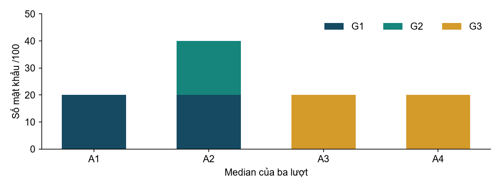
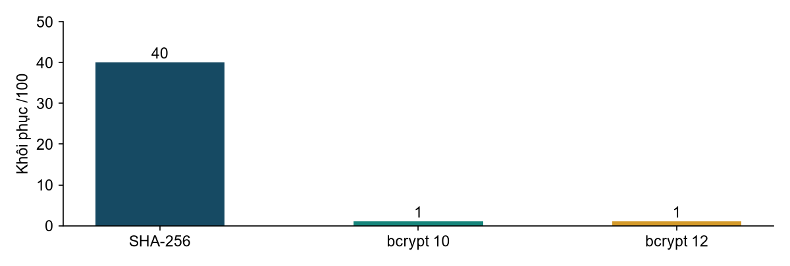
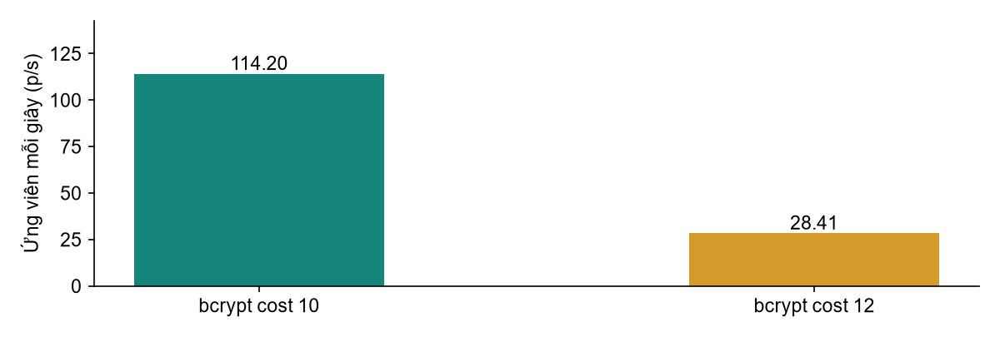

# Nghiên cứu John the Ripper

## Đánh giá các kỹ thuật dò mật khẩu ngoại tuyến

Môn học: An toàn thông tin nâng cao

Chủ đề 17: John the Ripper Password cracking techniques

Giảng viên: GVCC PGS TSKH Hoàng Đăng Hải

Nhóm: [Điền tên nhóm và lớp]

Ngày thực nghiệm: 29/10/2026

| Thành viên | Phần việc phụ trách theo kế hoạch | Thông tin cần điền |
|---|---|---|
| TV1 | Cơ sở, nguyên lý, kiểm chứng dữ liệu, kết luận | Họ tên và mã học viên |
| TV2 | Môi trường, dữ liệu, kỹ thuật dò, demo 1 | Họ tên và mã học viên |
| TV3 | Hàm băm, cost, so sánh, phân tích, demo 2 | Họ tên và mã học viên |

Phân công trên là đề xuất để nhóm tiếp nhận và rà soát. Bộ thực nghiệm và bản thảo này được triển khai với hỗ trợ của Codex; các thành viên cần tự chạy lại, hiểu kết quả và xác nhận đóng góp trước khi nộp.

<!-- page -->
# Tóm tắt và mục lục

Báo cáo khảo sát John the Ripper Jumbo qua hai kịch bản: thay đổi chiến lược sinh ứng viên trên cùng bộ hash và thay đổi cơ chế băm trên cùng bộ mật khẩu. Dữ liệu gồm 100 mật khẩu tổng hợp thuộc năm nhóm, một wordlist 1.000 mục và tập 4.000 ứng viên đã kiểm tra khớp với rules của John. Mỗi cấu hình chính chạy ba lần với ngân sách 60 giây/lượt trên Windows, bốn luồng OpenMP. Kết quả cho thấy wordlist khôi phục 20/100 mật khẩu; rules tăng lên 40/100; mask đúng cấu trúc tìm đủ 20 mật khẩu thuộc nhóm tương ứng. Các phép đo bcrypt và đối chứng một hash làm rõ tác động của cost. Hashcat được kiểm tra trong môi trường hiện có, với backend được ghi riêng để giới hạn suy luận. Kết quả minh họa vai trò đồng thời của cấu trúc mật khẩu, chiến lược đoán và chi phí xác minh. Những mật khẩu chưa khôi phục chỉ được đánh giá trong ngân sách và tập ứng viên đã thử.

| Phần | Nội dung | Trang |
|---|---|---|
| Mở đầu | Mục tiêu và câu hỏi nghiên cứu | 3 |
| Chương 1 | Mật khẩu, băm và cơ chế John | 4–5 |
| Chương 2 | Môi trường, dữ liệu và phương pháp đo | 6–8 |
| Chương 3 | Hai kịch bản và kết quả | 9–12 |
| Chương 4 | So sánh, giới hạn và phòng vệ | 13–14 |
| Kết luận | Trả lời các câu hỏi nghiên cứu | 15 |
| Tài liệu tham khảo và phụ lục | Nguồn và cách tái lập | 16–17 |

**Quy ước:** G1–G5 là nhóm dữ liệu; A là phép thử chiến lược; B là phép thử cơ chế băm; D là đối chứng một hash; C là kiểm tra Hashcat. Số liệu gốc nằm trong `lab/results/formal/`. Dữ liệu pilot phục vụ kiểm tra thiết lập, được lưu riêng.

<!-- page -->
# Mở đầu

Mật khẩu vẫn hiện diện trong nhiều hệ thống xác thực. Khi dữ liệu xác minh bị lộ, chi phí thử ứng viên phụ thuộc vào cách lưu mật khẩu và khả năng dự đoán lựa chọn của người dùng. Công cụ kiểm toán giúp khảo sát mối quan hệ này bằng các phép đo có kiểm soát. Đề tài chọn John the Ripper vì có thể quan sát nhiều cách sinh ứng viên trong cùng một quy trình ngoại tuyến [1].

Mục tiêu của báo cáo là giải thích cơ chế hoạt động, thiết lập thí nghiệm có thể chạy lại và rút ra nhận xét từ dữ liệu thực. Phạm vi gồm dữ liệu tổng hợp do nhóm tạo, raw SHA-256 làm đường cơ sở, bcrypt với cost 10 và 12, cùng một phần đối chiếu Hashcat. Mọi lượt chạy chỉ xử lý các tệp lab cục bộ.

| Câu hỏi | Nội dung cần trả lời |
|---|---|
| RQ1 | Các kỹ thuật sinh ứng viên phù hợp với nhóm mật khẩu nào? |
| RQ2 | Giả định cấu trúc đúng hoặc sai ảnh hưởng thế nào? |
| RQ3 | Cơ chế băm và cost thay đổi chi phí thử ra sao? |
| RQ4 | Có thể kết luận gì về John và Hashcat trong cấu hình được đo? |

Hai kịch bản chính gắn với các câu hỏi trên. Kịch bản 1 giữ nguyên hash để thay chiến lược. Kịch bản 2 giữ nguyên mật khẩu và tập ứng viên để thay cơ chế băm; đối chứng một hash giúp đọc tốc độ khi số mục tiêu không thay đổi. Single crack và mask sai là tiểu thử minh họa thuộc kịch bản 1.

Báo cáo dựa trên yêu cầu của học phần [0], tài liệu chính thức và log thực nghiệm. So với kế hoạch ban đầu, môi trường đo được điều chỉnh từ máy ảo Linux sang Windows native vì máy hiện có chưa có lab Linux. Ngân sách chuyển từ 300 xuống 60 giây/lượt sau pilot; các thay đổi áp dụng thống nhất trước đo chính thức. Gói kèm có hướng dẫn tái lập bằng Linux VM, nhưng số liệu trong bài là số đo trên Windows.

<!-- page -->
# Chương 1 Cơ sở về mật khẩu

## 1.1 Xác minh và dò mật khẩu

Trong mô hình thí nghiệm, hệ thống lưu giá trị dẫn xuất từ mật khẩu. Khi xác minh, cùng cơ chế được áp dụng lên giá trị nhập và kết quả được so sánh. Dò mật khẩu ngoại tuyến thực hiện thao tác này trên các ứng viên và dữ liệu xác minh đã có cục bộ. Chi phí không bao gồm một yêu cầu đăng nhập qua mạng cho mỗi ứng viên.

Thử đăng nhập trực tuyến còn chịu độ trễ, giới hạn tần suất và chính sách tài khoản. Vì vậy tốc độ tính trong lab không thể chuyển thẳng thành số lần đăng nhập thực tế. MFA và rate limiting thuộc lớp bảo vệ xác thực; việc bảo vệ dữ liệu hash cần xét riêng [8].

## 1.2 Salt và chi phí tính toán

Salt phân biệt giá trị dẫn xuất giữa các bản ghi, kể cả khi mật khẩu giống nhau. Cost điều khiển lượng công việc của cơ chế băm mật khẩu. Trong thí nghiệm bcrypt, mỗi bản ghi có salt riêng; cost 10 và 12 tương ứng tham số vòng lặp được John báo là 1.024 và 4.096. Việc tăng cost thay đổi lượng công việc tính toán; số đo thực còn phụ thuộc triển khai và phần cứng.

Raw SHA-256 được chọn làm đường cơ sở tính nhanh. Kết quả của nó không phải khuyến nghị lưu mật khẩu bằng hàm băm nhanh. Đối với ứng dụng mới, OWASP hướng dẫn dùng cơ chế chuyên dụng như Argon2id, với salt và tham số chi phí phù hợp [7].

## 1.3 Không gian tìm kiếm và entropy

Với L ký tự được chọn độc lập, đồng đều từ tập R ký tự, số chuỗi khả dĩ là N = R^L và entropy lý tưởng là H = L log₂ R. Điều kiện sinh là phần thiết yếu của mô hình. Một chuỗi dài có tên riêng hoặc hậu tố quen thuộc không tự đạt mức entropy lý tưởng chỉ vì chứa nhiều loại ký tự.

Mask của G3 có hai vị trí chữ thường và bốn vị trí chữ số, nên N = 26² × 10⁴ = 6.760.000. Nếu mở rộng thành sáu ký tự chữ thường hoặc số thì N = 36⁶ = 2.176.782.336, lớn hơn khoảng 322 lần. Đây là so sánh kích thước không gian, chưa phải tỷ lệ thời gian thực của hai thuật toán.

<!-- page -->
# Chương 1 Cơ chế John the Ripper

## 1.4 Luồng xử lý

Sơ đồ chức năng do báo cáo tổng hợp gồm: nạp hash và metadata; chọn định dạng; tạo ứng viên; tính giá trị tương ứng salt/cost; so khớp; ghi kết quả vào pot và log. John Jumbo cung cấp nhiều định dạng và backend; tính năng thực tế phải đối chiếu với đúng binary đang dùng [2].

| Thành phần | Vai trò trong lab |
|---|---|
| Bộ nạp và format | Kiểm tra, diễn giải raw SHA-256 hoặc bcrypt |
| Bộ sinh ứng viên | Wordlist, rules, mask, incremental, single |
| Bộ tính và so khớp | Tính giá trị theo định dạng, salt và cost |
| Pot | Lưu kết quả đã tìm được, tác động tới lượt sau |
| Session | Lưu trạng thái để theo dõi hoặc khôi phục |

## 1.5 Các kỹ thuật sinh ứng viên

Wordlist dùng danh sách đã có. Rules áp dụng biến đổi có quy tắc lên từ gốc, chẳng hạn viết hoa đầu hoặc nối hậu tố. Incremental ưu tiên các tổ hợp theo thống kê ký tự, trong giới hạn charset và chiều dài đã cấu hình. Single crack dùng metadata tài khoản, vì vậy cần đầu vào khác hash thuần [3].

Mask biểu diễn cấu trúc từng vị trí. Trong lab, `?l` là chữ thường ASCII và `?d` là chữ số. Chọn mask cần kiến thức hoặc giả thuyết về cấu trúc; giả định sai có thể loại toàn bộ đáp án khỏi tập thử [4].

Rules cố định trong lab gồm giữ nguyên, viết hoa đầu, viết hoa đầu và nối `2026!`, hoặc nối `123`. Cú pháp `c` và các phép nối được đối chiếu với tài liệu rules [5]. Xuất ứng viên bằng John và so sánh với tệp đã tạo cho kết quả trùng cả thứ tự lẫn 4.000 mục. Bước này giúp tránh việc hai công cụ mang tên cùng chiến lược nhưng thực tế thử các chuỗi khác nhau.

Một session mới không đảm bảo tập kết quả sạch nếu vẫn dùng chung pot. Các lượt đo đặt cả tên session và đường dẫn pot riêng; kết quả cũ không được tái sử dụng trong các phép so sánh độc lập [1, 6].

<!-- page -->
# Chương 2 Môi trường thực nghiệm

## 2.1 Cấu hình thực tế

| Thuộc tính | Giá trị |
|---|---|
| CPU | Intel(R) Core(TM) i7-7700HQ CPU @ 2.80GHz |
| Nhân vật lý / luồng logic | 4 / 8 |
| RAM máy | 15.9 GiB |
| Hệ điều hành | Windows-10-10.0.19045-SP0 |
| John | 1.9.0-jumbo-1, Cygwin x64, AVX2, OpenMP 4 luồng |
| Hashcat | 8.0.0; thiết bị theo environment/hashcat-devices.txt |
| Môi trường đo | Windows native, chưa dựng Linux VM |

John là bản Windows portable do Openwall phát hành. Bản 1.9.0-jumbo-1 đã cũ; báo cáo ghi phiên bản và checksum để nhận diện chính xác kết quả, không coi đây là đánh giá bản phát triển hiện hành. Mỗi phép đo John dùng bốn luồng OpenMP. Binary báo AVX2 và tự kiểm tra thành công với raw SHA-256, bcrypt. Toàn bộ đầu ra tự kiểm tra và danh sách format được giữ trong `lab/environment/`.

## 2.2 Cài đặt và kiểm tra

Tải gói từ trang chính thức, giải nén vào thư mục công cụ của lab, rồi kiểm tra build-info, format và chế độ incremental. Dữ liệu được tạo riêng; không dùng hash hay tài khoản của hệ thống đang vận hành. Tệp cấu hình thí nghiệm tham chiếu cấu hình gốc và thêm rules Lab, giữ bản gốc để đối chiếu.

Hashcat được tải từ trang chính thức và kiểm tra thiết bị bằng `-I`. Log thiết bị liệt kê Intel HD Graphics 630 và NVIDIA GTX 1050 ở OpenCL, nhưng không có CPU OpenCL backend. CUDA không khởi tạo được với runtime hiện có. Thử CPU được giữ lại như bằng chứng lỗi môi trường; thử GPU được ghi riêng nếu thành công.

Không thay driver hoặc cài runtime hệ thống trong quá trình đo. Sự khác biệt backend là một thuộc tính của môi trường thử, phải giữ trong cách diễn giải. Nếu lặp lại trên Linux VM, cần ghi lại CPU/backend và chạy lại toàn bộ cấu hình so sánh thay vì ghép số đo hai môi trường.

**Khả năng kiểm chứng:** checksum dữ liệu được kiểm tra trước mỗi lượt. `result.json` lưu lệnh đầy đủ, thời điểm bắt đầu, thời gian thực, exit code và đường dẫn terminal log. Người đọc có thể đối chiếu kết quả tổng hợp về từng lượt cụ thể.

<!-- page -->
# Chương 2 Bộ dữ liệu và biến kiểm soát

## 2.3 Dữ liệu có chủ đích

| Nhóm | Số mật khẩu | Cách sinh và mục đích |
|---|---:|---|
| G1 | 20 | Từ nằm trong wordlist; kiểm tra baseline |
| G2 | 20 | Từ gốc khác G1, viết hoa đầu và thêm 2026! |
| G3 | 20 | Hai chữ thường và bốn số, chọn bằng bộ sinh ngẫu nhiên |
| G4 | 20 | Chuỗi ngẫu nhiên dài 12–16, tập 70 ký tự |
| G5 | 20 | Ba từ chọn ngẫu nhiên, phân cách bằng dấu gạch nối |

Wordlist gồm 1.000 từ ghép tổng hợp từ các thành tố định trước. Tập ứng viên có 4.000 chuỗi khác nhau sau bốn rules. Đây là từ điển thí nghiệm nhằm kiểm tra cơ chế, không phải tập mật khẩu đại diện cho người dùng. G1 và G2 được thiết kế có thể tìm bằng các chiến lược tương ứng; tỷ lệ 20% hoặc 40% chỉ áp dụng cho cơ cấu dữ liệu này.

Mỗi mật khẩu được lưu trong ground truth cùng ID, nhóm, chiều dài và cách sinh. Raw SHA-256 và hai tập bcrypt cùng trỏ tới 100 ID đó. Bcrypt dùng salt riêng mỗi bản ghi; từng hash đã được kiểm tra lại bằng hàm xác minh. Bộ phụ single chứa tám tài khoản giả với mật khẩu trùng username. Phép thử này minh họa metadata, được phân tích riêng.

## 2.4 Đóng băng và tái lập

Các tệp wordlist, rules, hash, manifest và ground truth được băm SHA-256, ghi trong `data/checksums.json` trước đo chính thức. Dữ liệu ngẫu nhiên không dùng seed tái lập; bản dữ liệu đã lưu và checksum là căn cứ tái lập. Chạy lại script sinh dữ liệu sẽ tạo bộ ngẫu nhiên và salt mới, vì vậy không dùng thao tác đó để phục hồi chính bộ đã đo.

Biến giữ cố định gồm dữ liệu, rules, binary, số luồng và ngân sách. Các lượt chạy nối tiếp trên cùng máy; thứ tự cấu hình được xoay giữa ba lần lặp. Môi trường Windows có tác vụ nền và không có đo điện năng hoặc nhiệt độ liên tục; kết quả tốc độ cần đọc cùng giới hạn này.

<!-- page -->
# Chương 2 Phương pháp đo

## 2.5 Ma trận thực nghiệm

| Khối | Cấu hình | Số lần lặp | Giới hạn |
|---|---|---:|---|
| A1–A4 | Wordlist, rules, mask, incremental | 3 | 60 giây/lượt |
| B1–B3 | 4.000 ứng viên với SHA-256, bcrypt 10/12 | 3 | 60 giây/lượt |
| D1–D3 | Cùng ứng viên, một hash đối chứng vắng đáp án | 3 | 60 giây/lượt |
| A5–A6 | Mask sai và single với metadata | 1 | 30 giây/lượt |
| C | Kiểm tra Hashcat theo backend khả dụng | Theo log | Ghi rõ cấu hình |

Một lượt có thể kết thúc khi hết ứng viên trước ngân sách. Lượt bị giới hạn thời gian không mang ý nghĩa đã duyệt toàn bộ không gian. John có thể thoát sau mốc đặt do xử lý theo batch; báo cáo lưu thời gian tiến trình thực thay vì ép mọi lượt bằng đúng 60 giây.

## 2.6 Chỉ số và kiểm tra đúng

Tỷ lệ khôi phục là số ID có mật khẩu khớp ground truth chia tổng ID. Mỗi nhóm có mẫu số 20. Thời gian là wall clock của tiến trình từ lúc gọi đến khi kết thúc, bao gồm khởi động. Các lượt ngắn đặc biệt nhạy với chi phí này, nên không lấy tổng ứng viên chia wall clock để tuyên bố tốc độ hash thuần.

Tốc độ trong terminal được giữ nguyên nhãn p/s, c/s và C/s. Với D chỉ có một hash đang hoạt động và đáp án vắng trong tập ứng viên, p/s thuận tiện hơn để đối chiếu cost. Với B có nhiều salt và các hash bị loại sau khi tìm thấy, số ứng viên/giây không trực tiếp thay thế số phép tính hash/giây.

Mỗi cấu hình chính được tóm tắt bằng median và min–max của ba lần. Số lần lặp nhỏ giúp kiểm tra độ ổn định tại máy hiện có, không chứng minh đại diện cho quần thể phần cứng. Các mốc đọc pot được lưu như thời điểm quan sát tệp, không coi là thời điểm chính xác mật khẩu được tìm; bài không dựng đường tiến độ từ timestamp suy đoán.

<!-- page -->
# Chương 3 Kịch bản 1

## 3.1 Chiến lược sinh ứng viên

Cùng 100 hash raw SHA-256 được thử với A1 wordlist, A2 wordlist cộng rules, A3 mask đúng cấu trúc G3 và A4 incremental LowerNum dài 1–6. Mỗi lượt dùng pot riêng và cùng cấu hình bốn luồng.

| Phép thử | G1 | G2 | G3 | Tổng /100 | Wall giây¹ |
|---|---|---|---|---|---|
| A1 | 20 | 0 | 0 | 20 (20–20) | 0.37 (0.36–0.38) |
| A2 | 20 | 20 | 0 | 40 (40–40) | 0.36 (0.36–0.37) |
| A3 | 0 | 0 | 20 | 20 (20–20) | 0.61 (0.57–0.61) |
| A4 | 0 | 0 | 20 | 20 (20–20) | 60.80 (60.58–61.10) |

¹ Median (min–max), ba lượt. G4 và G5 đều bằng 0 trong các lượt A1–A4.



Wordlist tìm được G1 vì các từ này được đặt sẵn trong danh sách. Rules mở rộng sang G2 đúng như quy tắc tạo dữ liệu. Mask thu hẹp việc thử tới cấu trúc của G3; nó không chứa các từ dài G1/G2 hay chuỗi dài G4/G5. Incremental thử trong không gian rộng hơn nên kết quả trong ngân sách phụ thuộc thứ tự duyệt và mức độ bao phủ.

A4 khôi phục median 20/100 trong giới hạn thời gian, còn A3 hoàn tất mask với wall time median 0.61 giây. Vì hai cơ chế có thứ tự thử và overhead khác nhau, tỷ lệ không gian 322 lần không được coi là hệ số tăng tốc đo được. G4/G5 chưa được tìm trong các lượt này.

<!-- page -->
# Chương 3 Các tiểu thử của kịch bản 1

## 3.2 Giả định cấu trúc sai

Mask sáu chữ số A5 được chạy trên cùng tập raw SHA-256. Kết quả khôi phục là 0/100, wall time 0.40 giây. Các mật khẩu G3 đều bắt đầu bằng hai chữ cái, nên không nằm trong mask này. Đây là ví dụ về giới hạn do lựa chọn không gian, ngay cả khi thử hết mask. Thời gian chạy nhanh không sửa được việc đáp án vắng trong tập ứng viên.

## 3.3 Single crack và metadata

Tiểu thử A6 dùng tám tài khoản giả với username/GECOS/home directory. Mật khẩu được thiết kế trùng username để kiểm tra khả năng khai thác metadata. John khôi phục 8/8 mật khẩu giả lập, wall time 0.42 giây. Đầu vào này cung cấp thông tin mà các hash thuần của A1–A4 không có, vì vậy không gộp kết quả vào bảng xếp hạng tỷ lệ thành công.

## 3.4 Ví dụ trình diễn

Demo 1 bắt đầu từ một pot chưa tồn tại, hiển thị số hash nạp rồi chạy wordlist và rules với hai pot khác nhau. Sau đó chạy mask đúng, mask sai và dùng `--show` để xem kết quả. Người trình bày chỉ ra nhóm khớp với từng chiến lược, đồng thời mở manifest để giải thích dữ liệu được thiết kế ra sao.

Điểm cần nhấn mạnh là giả định đầu vào, không chỉ terminal có in mật khẩu. Nếu dùng chung pot sau wordlist, lượt rules có thể chỉ nạp các hash còn lại và số đo không còn độc lập. Vì vậy thư mục từng lượt chứa lệnh, pot, log và kết quả đối chiếu riêng.

**Trả lời RQ1–RQ2:** chiến lược có ích khi tập ứng viên chứa đáp án và ưu tiên chúng sớm. Mask đúng làm giảm không gian theo giả định cấu trúc; mask sai bỏ sót. Hiệu quả quan sát được không thể tách khỏi cơ cấu dữ liệu tổng hợp và thông tin được cung cấp cho công cụ.

<!-- page -->
# Chương 3 Kịch bản 2

## 3.5 Cơ chế băm và cost

B1–B3 cùng dùng tệp 4.000 ứng viên đã khóa. Dữ liệu mục tiêu lần lượt là raw SHA-256, bcrypt cost 10 và cost 12 của cùng 100 mật khẩu. Việc xuất ứng viên trước giúp giữ cách sinh và thứ tự thử cố định.

| Cấu hình | Khôi phục /100¹ | Wall giây¹ | Kết thúc |
|---|---|---|---|
| Raw SHA-256 | 40 (40–40) | 0.37 (0.35–0.39) | completed |
| bcrypt cost 10 | 1 (1–2) | 61.88 (61.39–62.21) | time_limit |
| bcrypt cost 12 | 1 (1–1) | 61.12 (61.11–61.17) | time_limit |

¹ Median (min–max), ba lượt; thời gian thực có thể vượt 60 giây do hoàn tất batch.



Raw SHA-256 khôi phục median 40/100, bcrypt cost 10 khôi phục 1 (1–2)/100 và cost 12 khôi phục 1 (1–1)/100. Với 100 salt riêng, công cụ phải thực hiện nhiều phép xác minh cho cùng một ứng viên. Trong ngân sách ngắn, đáp án có trong wordlist vẫn có thể chưa được xử lý tới; vì vậy mức khôi phục thấp không mâu thuẫn với thiết kế G1/G2.

Khác biệt raw SHA-256 và bcrypt đồng thời bao gồm thuật toán, salt và cost. Phép thử này đo tổng ảnh hưởng của cấu hình lưu, không cô lập riêng salt. Một kết quả thấp với bcrypt không có nghĩa công cụ không hỗ trợ định dạng; cần kiểm tra số hash được nạp, cost, tốc độ và nguyên nhân kết thúc trong log.

<!-- page -->
# Chương 3 Đối chứng một hash

## 3.6 Tách tác động của cost

D1–D3 dùng một mật khẩu đối chứng chắc chắn không nằm trong tập 4.000 ứng viên. Mỗi phép đo chỉ có một hash mục tiêu và không tìm được đáp án, nhờ đó số hash đang hoạt động không đổi. Đây là phép đo bổ sung thuộc kịch bản 2, giúp diễn giải tốc độ của cấu hình băm.

| Đối chứng | p/s¹ | Wall giây¹ | Kết thúc |
|---|---|---|---|
| Raw SHA-256 | 500000.00 (444444.00–500000.00) | 0.44 (0.36–0.55) | completed |
| bcrypt 10 | 114.20 (93.85–141.00) | 35.43 (28.76–43.10) | completed |
| bcrypt 12 | 28.41 (25.89–30.19) | 61.76 (61.19–62.51) | time_limit |

¹ Median (min–max) tốc độ p/s cuối do John báo và wall time. Mỗi lượt chỉ có một hash.



Tốc độ bcrypt cost 10 có median 114.20 p/s; cost 12 là 28.41 p/s. Tỷ số tương ứng 4.02 lần, gần mức tăng công việc 4 lần của tham số vòng lặp. Kết luận chỉ áp dụng cấu hình đã đo; tốc độ còn chịu ảnh hưởng tải nền và batch.

Với raw SHA-256, tập 4.000 mục quá nhỏ để dùng wall time làm benchmark ổn định. Phép đo này chỉ xác nhận công cụ hoàn thành nhanh trên dữ liệu nhỏ. Các giá trị tốc độ hiển thị trong những phiên rất ngắn được giữ trong log để kiểm chứng, không dùng làm cơ sở công bố chênh lệch hiệu năng phổ quát.

**Trả lời RQ3:** tăng chi phí xác minh có thể giảm số ứng viên thử trong cùng ngân sách. Với bcrypt, cost 10 và 12 giữ cùng họ thuật toán, trong khi raw SHA-256 là cấu hình đường cơ sở khác. Tỷ lệ đo giữa hai cost là quan sát trên binary, số luồng và máy cụ thể.

<!-- page -->
# Chương 4 So sánh với Hashcat

## 4.1 So sánh chức năng

| Tiêu chí trong phạm vi đề tài | John Jumbo | Hashcat |
|---|---|---|
| Đầu vào | Hash và metadata tùy format | Hash theo mode và định dạng tương ứng |
| Sinh ứng viên liên quan | Wordlist, rules, mask, incremental, single | Wordlist, rules, mask và các chế độ khác |
| Backend | Tùy format và bản build | Tùy runtime và thiết bị |
| Quản lý kết quả | Pot và session | Potfile và session/restore |
| Kiểm chứng tại máy | Build-info, self-test, terminal log | Device info và terminal log |

Các tính năng trong bảng được đối chiếu tài liệu [2, 9] và binary. Bảng chỉ bao phủ tiêu chí liên quan đến lab, không đánh giá toàn bộ tính năng hay xếp hạng công cụ.

## 4.2 Thử nghiệm tại môi trường hiện có

Thử CPU không thực hiện được do thiếu backend. Thử GPU Intel HD Graphics 630 với Hashcat khôi phục median 40/100 từ cùng 4.000 ứng viên; wall time median 2.14 giây (2.13–14.62), ba lượt. John CPU trên cùng tập ứng viên khôi phục 40/100, wall time 0.37 (0.35–0.39) giây. Đây là hai cấu hình triển khai khác nhau; không suy hệ số tăng tốc phần mềm từ wall time này.

Tệp ứng viên giữ nguyên checksum khi chuyển công cụ. Đây là điều kiện cần cho so sánh nhưng chưa đủ: thiết bị, backend, số luồng và chi phí khởi động cũng cần tương đương. Khối lượng 4.000 ứng viên raw SHA-256 rất nhỏ nên phần khởi tạo có thể chi phối tổng thời gian.

**Trả lời RQ4:** chỉ có thể kết luận về khả năng thực hiện và hành vi quan sát được trong cấu hình đã ghi. Kết quả xác nhận hai cấu hình tìm cùng các mật khẩu có trong tập ứng viên. Chưa có phép đo hiệu năng cùng backend giữa hai công cụ. Phép so sánh hiệu năng chặt hơn cần cùng thiết bị, dữ liệu đủ lớn, trạng thái warm-up được kiểm soát và nhiều lần đo phù hợp.

<!-- page -->
# Chương 4 Thảo luận và phòng vệ

## 4.3 Giới hạn của nghiên cứu

Thứ nhất, bộ dữ liệu được tạo có chủ đích, với nhóm từ điển và biến thể có tỷ trọng cố định. Tỷ lệ khôi phục phản ánh đúng thiết kế đó nhưng không ước lượng tỷ lệ mật khẩu yếu của một tổ chức. G5 chỉ có 20 cụm từ sinh theo một cách; không đại diện mọi passphrase.

Thứ hai, ngân sách 60 giây và ba lượt lặp cho mỗi cấu hình là giới hạn của nghiên cứu. Mật khẩu không tìm được có thể nằm ngoài tập ứng viên hoặc chưa được ưu tiên tới. Không chuyển các quan sát đó thành cam kết về thời gian an toàn dài hạn.

Thứ ba, máy Windows có tải nền không được đo liên tục, bản John portable đã cũ và Hashcat phụ thuộc runtime hiện có. Bài không đo năng lượng, khả năng mở rộng nhiều thiết bị hay hiệu quả trên máy chủ. Thực nghiệm chưa được lặp trong Linux VM của học phần.

## 4.4 Khuyến nghị từ kết quả

Kết quả G2 cho thấy biến đổi dễ dự đoán có thể được đưa vào rules với chi phí chuẩn bị nhỏ. Người dùng nên ưu tiên mật khẩu dài, được sinh khó đoán, khác nhau giữa các dịch vụ và quản lý bằng công cụ phù hợp. Chính sách xác thực nên cân nhắc blocklist, hỗ trợ trình quản lý mật khẩu và MFA theo hướng dẫn NIST [8].

Phía hệ thống cần dùng cơ chế lưu mật khẩu chuyên dụng có salt riêng và lựa chọn tham số theo khả năng phục vụ thực tế. Bcrypt trong bài minh họa cost; với thiết kế mới có thể tham khảo Argon2id và các tham số bộ nhớ/thời gian trong RFC 9106 [10]. Không sao chép tham số lab thành cấu hình sản xuất mà chưa đo tải xác thực.

Rate limiting giúp hạn chế thử đăng nhập trực tuyến. Với tình huống dữ liệu hash đã bị lấy, kết quả của B và D nhấn mạnh vai trò của chi phí xác minh và độ khó đoán. Cần phối hợp bảo vệ dữ liệu xác minh, quản lý bí mật và phản ứng khi có lộ lọt; một biện pháp đơn lẻ không giải quyết hết các lớp rủi ro.

<!-- page -->
# Kết luận

Đề tài đã thiết lập dữ liệu tổng hợp có ground truth, kiểm tra 4.000 ứng viên khớp rules, thực hiện các lượt đo độc lập và lưu lệnh cùng log. Kết quả chiến lược cho thấy sự phù hợp giữa tập ứng viên và cách tạo mật khẩu quyết định nhóm nào được khôi phục. Wordlist khôi phục G1; rules bao phủ thêm G2; mask đúng cấu trúc bao phủ G3, trong khi mask sai không chứa đáp án.

Trong kịch bản 2, bcrypt cost 10 và 12 khôi phục median lần lượt 1 và 1/100 trong ngân sách 60 giây. Đối chứng một hash ghi nhận median 114.20 và 28.41 p/s, chênh lệch 4.02 lần. Những số đo này cho thấy tăng cost làm giảm khả năng thử trong cùng thời gian ở môi trường nghiên cứu.

Qua các phép thử này, báo cáo trả lời bốn câu hỏi nghiên cứu trong phạm vi cấu hình đã công bố. Điểm có thể kiểm chứng là liên kết từ nhận xét tới bảng số liệu, từ bảng tới mã lượt và từ mã lượt tới lệnh, cấu hình, hash và pot. Đây là nền tảng để nhóm tự lặp lại và kiểm tra kết luận.

Các kết quả không đại diện mọi mật khẩu hoặc mọi nền tảng. Đặc biệt, không tìm được một mật khẩu trong ngân sách ngắn không chứng minh nó an toàn, và thời gian khởi tạo của công cụ không phản ánh tốc độ tính hash ổn định. Phân tích cần giữ cả quan sát thành công, thất bại và điều kiện không cho phép so sánh.

Hướng tiếp tục gồm dựng Linux VM theo yêu cầu học phần, chạy lại cùng bộ dữ liệu, mở rộng tập ứng viên đủ lớn cho đánh giá tốc độ, đo cùng backend giữa John và Hashcat, và nghiên cứu KDF dùng bộ nhớ. Mỗi mở rộng cần bổ sung thiết kế kiểm soát trước khi thu số liệu.

**Việc nhóm cần hoàn tất trước khi nộp:** điền thông tin thành viên/lớp; xác nhận phân công thực tế; tự chạy lại ít nhất một lượt; rà yêu cầu máy ảo và biểu mẫu hiện tại; diễn tập giải thích dữ liệu, cost và giới hạn kết luận. Tài liệu không gán hoạt động thực nghiệm cho cá nhân khi chưa có xác nhận của thành viên.

<!-- page -->
# Tài liệu tham khảo

[0] Học viện Công nghệ Bưu chính Viễn thông. Tài liệu môn An toàn thông tin nâng cao, chuyên đề 1, slide 4–5 và 41. Bản văn bản trích xuất trong thư mục nguồn của bài.

[1] Openwall. John the Ripper documentation. https://www.openwall.com/john/doc/

[2] Openwall. John the Ripper jumbo source repository và trang tải công cụ. https://github.com/openwall/john và https://www.openwall.com/john/

[3] Openwall. John the Ripper cracking modes. https://www.openwall.com/john/doc/MODES.shtml

[4] Openwall. Jumbo MASK documentation. https://raw.githubusercontent.com/openwall/john/bleeding-jumbo/doc/MASK

[5] Openwall. Wordlist rules syntax. https://www.openwall.com/john/doc/RULES.shtml

[6] Openwall. Jumbo command line options. https://raw.githubusercontent.com/openwall/john/bleeding-jumbo/doc/OPTIONS

[7] OWASP Foundation. Password Storage Cheat Sheet. https://cheatsheetseries.owasp.org/cheatsheets/Password_Storage_Cheat_Sheet.html

[8] NIST. SP 800-63B-4 Digital Identity Guidelines Authentication and Authenticator Management. https://pages.nist.gov/800-63-4/sp800-63b.html

[9] Hashcat. Documentation, download và example hashes. https://hashcat.net/wiki/doku.php?id=hashcat và https://hashcat.net/hashcat/

[10] Biryukov A, Dinu D, Khovratovich D, Josefsson S. RFC 9106 Argon2 Memory Hard Function for Password Hashing and Proof of Work Applications. 2021. https://www.rfc-editor.org/rfc/rfc9106.html

Ngày truy cập nguồn trực tuyến: 29/10/2026. Binary John trong phép đo là 1.9.0-jumbo-1 Windows x64, không đồng nhất với nhánh bleeding-jumbo. Với cú pháp thực thi, ưu tiên log/self-test và tài liệu đi kèm binary; các trang hiện hành dùng để đối chiếu nguyên lý. Thông tin nguồn và checksum nằm trong gói tái lập.

<!-- page -->
# Phụ lục Cách tái lập và trình diễn

## A Tái lập trên bộ dữ liệu đã đo

Giữ nguyên các tệp data và ground truth; không chạy lại bộ sinh nếu muốn dùng đúng dữ liệu của bài. Cài công cụ từ nguồn chính thức nếu không dùng bản portable kèm theo, kiểm tra môi trường và sửa đường dẫn binary trong runner khi cần. Mọi thay đổi binary/backend tạo một loạt kết quả mới.

Lệnh runner Windows mẫu, tại thư mục lab, với Python 3:

```text
python scripts/run_lab.py --phase setup
python scripts/run_lab.py --phase formal --budget 60
```

Runner bảo vệ kết quả cũ bằng cách từ chối ghi đè thư mục lượt đã tồn tại. Để chạy lại, sao chép cả lab sang thư mục mới hoặc lưu trữ results cũ trước; không trộn pot giữa các loạt. Các lệnh chính xác của loạt báo cáo nằm trong `result.json` từng lượt.

## B Lệnh minh họa John

```text
john --format=raw-sha256 --wordlist=data/wordlist.txt
  --pot=results/demo-wordlist.pot data/sha256.txt
john --format=raw-sha256 --mask=?l?l?d?d?d?d
  --pot=results/demo-mask.pot data/sha256.txt
```

Các dòng trên được xuống hàng để trình bày; xem script demo để chạy nguyên lệnh. Pot demo phải là tệp mới. Demo 2 dùng cùng tệp candidates với raw SHA-256 và bcrypt, sau đó giải thích cost, số salt và nguyên nhân dừng từ log đã đo.

## C Gói bàn giao

`README.md` hướng dẫn bắt đầu; `report/` chứa bài và bản nguồn; `slides/` chứa thuyết trình; `lab/` chứa cấu hình, dữ liệu, code và kết quả; `references/` chứa ghi chú tìm hiểu; `demo/` chứa kịch bản và câu hỏi phản biện. Hướng dẫn Linux VM mô tả bước thực hiện tiếp theo, không thay thế bằng chứng số đo Windows trong bài.
